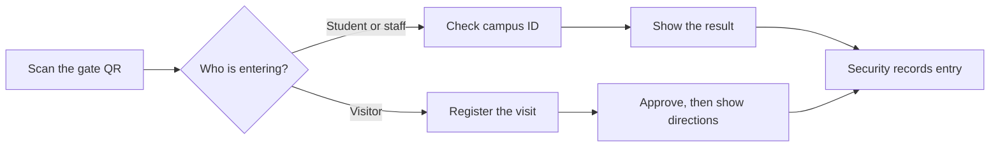

<p align="center">
  <strong>Adventist University of Central Africa</strong><br>
  <h1>Smart Gate Pass</h1>
  <p>Verify a campus ID, register a visitor, and record who entered the gate.</p>
</p>

<p align="center">
  
  
  
  
</p>

Scanning the QR code at the entrance opens this site. It does not grant access. The person identifies themselves, the system checks the record, and security confirms the result.

| Person | What they do |
| --- | --- |
| Student or staff | Enter a campus ID. The system checks it against a registered record. |
| Visitor | Submit a short form, choose an office, and receive a reference number plus directions. |
| Security officer | Approve a visit, then record entry and exit. |
| Administrator | Manage members, offices, and reports. |

Visitors do not need an account. Officers and administrators sign in. The public form never opens the management dashboard.



## The group

`main` is the shared branch. Feature work happens on `Sam`, `Jackson`, and `JP`, then comes back through a pull request.

| Branch | Person | Folder | Build this first |
| --- | --- | --- | --- |
| `main` | Everyone | — | Review and merge. Do not start features here. |
| [`Sam`](https://github.com/sammyniyo/WebTechMidTerm-Exam/tree/Sam) | Sam | `accounts/` | `CampusMember`, login roles, `/verify/` |
| [`Jackson`](https://github.com/sammyniyo/WebTechMidTerm-Exam/tree/Jackson) | Jackson | `campus/` | `Building`, `Office`, office create / read / update / delete |
| [`JP`](https://github.com/sammyniyo/WebTechMidTerm-Exam/tree/JP) | JP | `gatepass/`, `dashboard/` | `VisitorVisit`, `GateEvent`, AdminLTE stats |

A visit points at an office. A gate event points at either a campus member or a visit. Sam and Jackson merge `CampusMember` and `Office` into `main` before JP adds those foreign keys.

The full checklist for each person is in [TASKS.md](TASKS.md).

### Pages

| Address | App | Owner |
| --- | --- | --- |
| `/` | Public home | Shared |
| `/login/` `/logout/` `/verify/` | `accounts` | Sam |
| `/api/accounts/verify/` | `accounts` | Sam. Public JSON check for the gate app. |
| `/api/accounts/members/` | `accounts` | Sam. Signed-in security staff only. |
| Office directory | `campus` | Jackson |
| `/visitor/` | `gatepass` | JP |
| `/visitor/pass/<reference>/qr.svg` | `gatepass` | Visitor pass QR. Officers who scan it land on the visit's desk page. |
| `/visitor/gate-poster/` | `gatepass` | Printable gate poster. Its QR opens the visitor form. Staff only. |
| `/dashboard/` | `dashboard` | JP |
| `/admin/` | Django admin | Shared |

Add a new page in your own `urls.py`. `config/urls.py` already includes every app.

### Accounts API

JP and Jackson should call these endpoints instead of reading the accounts tables directly. The same check is available in Python:

```python
from accounts.services import verify_campus_id

verify_campus_id("20251MBI049", member_type="student")
```

`id` in the JSON is the campus card number. `recordId` is the database key to store on a gate event.

```http
GET /api/accounts/verify/?id=20251MBI049&member_type=student
POST /api/accounts/verify/
{"id": "STF2016BUS008", "member_type": "staff"}
```

```json
{
  "verified": true,
  "access": "allowed",
  "reason": "Active student record.",
  "member": {
    "recordId": 1,
    "id": "20251MBI049",
    "memberType": "student",
    "name": "NIYOMUHOZA Samuel",
    "status": "ACTIVE",
    "departmentCode": "MBI"
  }
}
```

A known person who is suspended, on leave, or the wrong type comes back `verified: true` and `access: "denied"`. An unknown ID comes back `verified: false`. The public check does not include the national ID or birth date.

The full campus record is only for a signed-in security officer or administrator.

```http
GET /api/accounts/members/?member_type=staff&status=ACTIVE
GET /api/accounts/members/STF2016BUS008/
```

A student record follows the campus student file: `academicLevel`, `studyMode`, `admittedTermId`, and the high-school fields. A staff record uses the same identity fields, then employment instead of academics:

```json
{
  "id": "STF2016BUS008",
  "memberType": "staff",
  "name": "MUKAMANA Grace",
  "status": "ACTIVE",
  "departmentCode": "BUS",
  "position": "Lecturer",
  "staffCategory": "ACADEMIC",
  "employmentType": "FULL_TIME",
  "hireDate": "2016-08-15",
  "officeCode": "BUS-210"
}
```

Load the sample rows with `python manage.py seed_members`. Try student `20251MBI049`, staff `STF2016BUS008`, and on-leave staff `STF2022SEC001`.

### Touch these together

A change here affects all three branches. Send a short pull request, and say so in the group chat first.

`config/settings.py` · `config/urls.py` · `templates/base.html` · `requirements.txt`

## Run it locally

You need Python 3.12 or newer. This repository was created with Python 3.14 and Django 5.2.

```bash
git clone git@github.com:sammyniyo/WebTechMidTerm-Exam.git
cd WebTechMidTerm-Exam
git checkout Sam    # Jackson or JP, if that is your branch

python3 -m venv .venv
source .venv/bin/activate
pip install -r requirements.txt

cp .env.example .env
```

Open `.env` and set `DB_PASSWORD`. The other database values are already filled in. Django reads `.env` when it starts. Nothing in `settings.py` stores the password.

```bash
python manage.py migrate
python manage.py createsuperuser
python manage.py runserver
```

| Page | Address |
| --- | --- |
| Public home | http://127.0.0.1:8000/ |
| Staff login | http://127.0.0.1:8000/login/ |
| Django admin | http://127.0.0.1:8000/admin/ |

`.env` and `.venv/` stay on your computer. Both are gitignored.

### Demo accounts

For a demonstration, one command builds a local SQLite database with sample data, trained models, and two demo accounts:

```bash
DB_ENGINE=sqlite python manage.py setup_demo
DB_ENGINE=sqlite python manage.py runserver
```

| Role | Username | Password | Can do |
| --- | --- | --- | --- |
| Administrator | `admin` | `admin12345` | Everything, including Django admin and retraining the models |
| Security officer | `officer` | `officer12345` | Desk pages: visitors, check-in, gate log, insights |

Sign in at http://127.0.0.1:8000/login/, then open http://127.0.0.1:8000/dashboard/insights/.

These accounts are for local demos only. `setup_demo` refuses to run against the shared MySQL database, and it never resets the password of an account that already exists.

### Database

MySQL is hosted at `srv1429.hstgr.io`. Remote MySQL in hPanel must allow your current IP address, or the connection is refused. When the app itself is running on Hostinger, set `DB_HOST=127.0.0.1` in that server's environment. Do not use the external hostname from inside Hostinger.

| Variable | Purpose |
| --- | --- |
| `DJANGO_SECRET_KEY` | Django secret. Use a long random string of your own. |
| `DJANGO_DEBUG` | `True` while developing. |
| `DJANGO_ALLOWED_HOSTS` | Comma-separated hosts. |
| `DB_NAME` | `u503615494_auca_get_pass` |
| `DB_USER` | Same as the database name. |
| `DB_PASSWORD` | The password you set in hPanel. Never commit this. |
| `DB_HOST` | `srv1429.hstgr.io` from your laptop. `127.0.0.1` on the server. |
| `DB_PORT` | `3306` |

## Push your branch and open a pull request

Work on your own branch. A pull request is how that work gets into `main`. Do not push commits straight to `main`.

| Person | Push this branch | Compare link |
| --- | --- | --- |
| Sam | `Sam` | [Open a pull request](https://github.com/sammyniyo/WebTechMidTerm-Exam/compare/main...Sam) |
| Jackson | `Jackson` | [Open a pull request](https://github.com/sammyniyo/WebTechMidTerm-Exam/compare/main...Jackson) |
| JP | `JP` | [Open a pull request](https://github.com/sammyniyo/WebTechMidTerm-Exam/compare/main...JP) |

The commands below use `Sam`. Jackson and JP replace that name with their own branch, and `git add` only the folder they own.

### 1. Update your branch

```bash
git checkout main
git pull origin main
git checkout Sam
git merge main
```

The first time on a new computer, the branch may not exist locally yet:

```bash
git fetch origin
git checkout Sam
```

### 2. Commit your files

```bash
git status
git add accounts
git commit -m "Add campus member verification."
```

Leave `.env` untracked. `git status` should not list it.

### 3. Push to your branch

```bash
git push -u origin Sam
```

`-u` is only needed the first time. After that, `git push` is enough. This updates `Sam` on GitHub. It does not change `main`.

### 4. Open the pull request

On GitHub, use the compare link in the table above. Set the base branch to `main` and the compare branch to your own. The title should say what the change does, for example `Add campus member verification`.

Or, from the terminal, after `gh auth login`:

```bash
gh pr create --base main --head Sam --title "Add campus member verification." --body "$(cat <<'EOF'
## Summary
- Add the CampusMember model and the ID verification page.

## Test plan
- [ ] `python manage.py check`
- [ ] Valid campus ID shows verified
- [ ] Unknown ID is rejected

EOF
)"
```

One pull request should be one feature: a model, a form, or a page. After it is merged, the other two people merge `main` into their branches before they continue.

Before you open it:

```bash
python manage.py check
python manage.py makemigrations --check --dry-run
python manage.py test
```

Open the page you changed and click through it. Add a screenshot when the change is visible.

### If Git reports a conflict

Merge `main` into your branch, fix the marked lines, then push your branch again. Do not force-push `main`, and do not commit on someone else's branch.

```bash
git checkout Sam
git fetch origin
git merge origin/main
git push origin Sam
```

## Layout

```text
WebTechMidTerm-Exam/
├── manage.py
├── requirements.txt
├── .env.example          # template — copy to .env
├── config/               # settings and the root URL list
├── accounts/             # Sam
├── campus/               # Jackson
├── gatepass/             # JP
├── dashboard/            # JP
├── templates/
│   ├── base.html
│   ├── public/
│   ├── accounts/
│   └── dashboard/
└── static/css/
```

Inside an app, `models.py` defines the tables, `forms.py` checks the input, `views.py` handles the request, and `urls.py` attaches the address.
